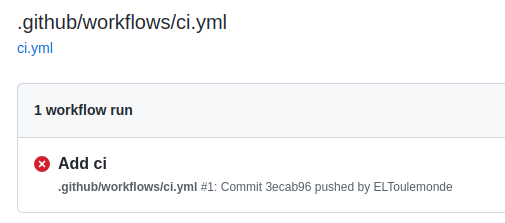

summary: TP4 - Créer une CI GitHub
id: tp4
categories: setup
tags: setup
status: Published
authors: OCTO Technology
Feedback Link: https://github.com/octo-technology/Formation-MLOps-1/issues/new/choose

# TP4 - Créer une CI GitHub

## Vue d'ensemble

Duration: 0:01:00

Pour réaliser ce TP, allez sur la branche `4_start_ci` depuis la racine du dépôt :

```shell
git stash --include-untracked
git checkout 4_start_ci
uv sync --locked
```

Nouveauté sur cette branche :
- La documentation Sphinx est créée.

L'objectif de ce TP est de créer une CI qui valide automatiquement notre code.

## Créer un compte GitHub

Duration: 0:10:00

Vous avez besoin de votre propre compte GitHub pour pouvoir pousser du code et exécuter la CI.

1. Créez un compte GitHub si vous n'en avez pas déjà un.
2. Créez un dépôt vide, sans README ni fichier `.gitignore`.
3. Modifiez l'URL du dépôt distant `origin` en local.
    - Affichez les URL actuelles avec `git remote -v` et conservez l'URL d'origine pour la fin du TP.
    - Exécutez `git remote set-url origin URL_DE_VOTRE_DEPOT`, en remplaçant `URL_DE_VOTRE_DEPOT` par l'URL SSH ou HTTPS de votre dépôt GitHub.
4. Poussez la branche actuelle vers votre dépôt : `git push --set-upstream origin 4_start_ci`.

Vous pouvez aussi créer un fork du dépôt en incluant toutes les branches, puis le cloner et vous placer sur `4_start_ci`. Exécutez alors `uv sync --locked` dans ce clone.

Dans l'interface GitHub, ouvrez l'onglet « Actions ». Après un push, vous devriez y trouver une exécution de la CI en échec.



## Corriger le fichier de CI

Duration: 0:20:00

Dans cette branche, vous avez un fichier `.github/workflows/ci.yml`. Complétez cette CI pour valider automatiquement votre code à chaque push.

Votre but est de compléter le fichier pour que votre CI fonctionne et soit verte.

Procédez étape par étape :
1. Testez la commande localement dans votre terminal.
2. Placez-la dans le fichier `ci.yml`.
3. Poussez votre code pour valider qu'il fonctionne.

Le workflow doit récupérer le code, installer uv et une version de Python compatible avec `pyproject.toml`, puis exécuter les vérifications depuis la racine du dépôt :

```sh
uv sync --locked
uv run ruff check src tests docs
uv run ruff format --check src tests docs
uv run python -m pytest
uv run sphinx-build -W -b html docs docs/_build/html
```

La CI vérifie la mise en forme sans modifier les fichiers. Pour corriger la mise en forme localement, utilisez `uv run ruff format src tests docs`.

Vous pouvez ensuite ajouter les analyses Bandit et Vulture présentes dans les dépendances de développement.

Pour analyser les vulnérabilités des dépendances, utilisez [Trivy](https://trivy.dev/latest/docs/). Cet outil s'installe séparément de l'environnement Python et lit directement `uv.lock`. Après son [installation](https://trivy.dev/latest/getting-started/installation/), lancez le même scan qu'en CI :

```sh
trivy fs --config trivy.yaml .
```

Le fichier `trivy.yaml` inclut les dépendances de production et de développement, exclut les environnements et fichiers générés, et fait échouer le scan si une vulnérabilité de sévérité `HIGH` ou `CRITICAL` est détectée.

En CI, l'action `aquasecurity/trivy-action@v0.36.0` installe Trivy et exécute ce scan. Configurez `scan-type: fs`, `scan-ref: .`, `trivy-config: trivy.yaml` et `version: v0.76.1`. Le scan ne nécessite ni compte payant ni clé API.

## Si vous avez fini en avance

Vous pouvez explorer les possibilités avec la [documentation GitHub Actions](https://docs.github.com/en/actions/automating-builds-and-tests/building-and-testing-python).

## Avant de changer de TP

Duration: 0:02:00

Si vous avez modifié `origin` dans le clone de la formation, restaurez l'URL conservée au début du TP :
```shell
git remote set-url origin https://github.com/octo-technology/Formation-MLOps-1.git
```

## Lien vers le TP suivant

Duration: 0:01:00

Les instructions du TP suivant sont [ici](https://octo-technology.github.io/Formation-MLOps-1/tp5#0).
