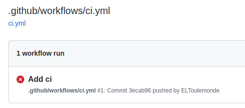

summary: TP4 - Créer une CI GitHub
id: tp4
categories: tp
tags: tp
status: Published
authors: OCTO Technology
Feedback Link: https://github.com/octo-technology/Formation-MLOps-1/issues/new/choose

# TP4 - Créer une CI GitHub

## Vue d'ensemble

Duration: 0:01:00

Pour réaliser ce TP, allez sur la branche `4_start_ci` depuis la racine du dépôt :

```shell
git stash --include-untracked
git switch 4_start_ci
uv sync --locked
```

Nouveautés sur cette branche :
- La documentation Sphinx est créée.
- Nouvelle commande : `make sphinx` (construit la documentation).
- Un fichier `.github/workflows/ci.yml` à compléter : la CI échoue tant qu'il n'est pas complété.
- Le fichier `trivy.yaml`, qui configure l'analyse des dépendances.

L'objectif de ce TP est de créer une CI qui valide automatiquement notre code.

## Échauffement Git (facultatif)

Duration: 0:15:00

Dans ce TP, vous allez pousser votre code sur GitHub : branches, commits et dépôt distant. Pour revoir ces notions avant de commencer, entraînez-vous sur [Learn Git Branching](https://learngitbranching.js.org/), un tutoriel interactif qui dessine l'historique du dépôt à chaque commande.

Faites 4 exercices au choix, par exemple les premiers niveaux de la séquence d'introduction (commit, branche, merge, rebase), puis ceux sur les dépôts distants (clone, fetch, pull, push), proches de ce que vous ferez ensuite.

Si vous êtes déjà à l'aise avec Git, passez directement à l'étape suivante.

## Créer un compte GitHub

Duration: 0:10:00

Vous avez besoin de votre propre compte GitHub pour pouvoir pousser du code et exécuter la CI. Vous poussez sur votre dépôt, jamais sur celui de la formation.

1. Créez un compte GitHub si vous n'en avez pas déjà un.
2. Créez un dépôt vide, sans README ni fichier `.gitignore`.
3. Remplacez l'URL du dépôt distant `origin` par l'URL SSH ou HTTPS de votre dépôt, puis vérifiez que `git remote -v` l'affiche :

```shell
git remote set-url origin URL_DE_VOTRE_DEPOT
git remote -v
```

4. Poussez la branche actuelle vers votre dépôt :

```shell
git push --set-upstream origin 4_start_ci
```

En HTTPS, GitHub refuse votre mot de passe au moment du push : utilisez un [token d'accès personnel](https://docs.github.com/en/authentication/keeping-your-account-and-data-secure/managing-your-personal-access-tokens) à la place, ou passez par SSH.

Gardez cette URL jusqu'à la fin de la formation : vos push partiront toujours vers votre dépôt. Les branches des TP suivants restent accessibles avec `git switch`, car elles ont été récupérées lors du clonage.

Alternative : Vous pouvez aussi créer un fork du dépôt en incluant toutes les branches, puis le cloner et vous placer sur `4_start_ci`. Exécutez alors `uv sync --locked` dans ce clone.

Dans l'interface GitHub, ouvrez l'onglet « Actions ». Après un push, vous devriez y trouver une exécution de la CI en échec.

L'onglet affiche aussi le workflow `TP starting state` (`.github/workflows/tp-validation.yml`). Il vérifie l'état de départ de la branche pour les formateurs et ne s'exécute pas sur votre dépôt : ne le modifiez pas.



## Corriger le fichier de CI

Duration: 0:20:00

Dans cette branche, vous avez un fichier `.github/workflows/ci.yml`. Complétez cette CI pour valider automatiquement votre code à chaque push.

Votre but est de compléter le fichier pour que votre CI fonctionne et soit verte.

Procédez étape par étape :
1. Testez la commande localement dans votre terminal.
2. Placez-la dans le fichier `ci.yml`.
3. Commitez et poussez votre code, puis vérifiez le résultat dans l'onglet « Actions » :

```shell
git add .github/workflows/ci.yml
git commit -m "Compléter la CI"
git push
```

Si vous avez activé le hook `pre-commit` au TP2, il se lance à chaque commit : il vérifie le code avec Ruff, lance les tests et refuse le commit si une vérification échoue.

Le workflow doit récupérer le code, installer uv et une version de Python compatible avec `pyproject.toml`, puis exécuter les vérifications depuis la racine du dépôt :

```sh
uv sync --locked
uv run ruff check src tests docs
uv run ruff format --check src tests docs
uv run python -m pytest
uv run sphinx-build -W -b html docs docs/_build/html
```

La CI vérifie la mise en forme sans modifier les fichiers. Pour corriger la mise en forme localement, utilisez `uv run ruff format src tests docs`.

Vous pouvez ensuite ajouter les analyses Bandit et Vulture présentes dans les dépendances de développement.

Pour analyser les vulnérabilités des dépendances, utilisez [Trivy](https://trivy.dev/latest/docs/). Cet outil s'installe séparément de l'environnement Python et lit directement `uv.lock`. Après son [installation](https://trivy.dev/latest/getting-started/installation/), lancez le même scan qu'en CI :

```sh
trivy fs --config trivy.yaml .
```

Le fichier `trivy.yaml` inclut les dépendances de production et de développement, exclut les environnements et fichiers générés, et fait échouer le scan si une vulnérabilité de sévérité `HIGH` ou `CRITICAL` est détectée.

En CI, l'action `aquasecurity/trivy-action@v0.36.0` installe Trivy et exécute ce scan. Configurez `scan-type: fs`, `scan-ref: .`, `trivy-config: trivy.yaml` et `version: v0.76.1`. Le scan ne nécessite ni compte payant ni clé API.

## Si vous avez fini en avance

Vous pouvez explorer les possibilités avec la [documentation GitHub Actions](https://docs.github.com/en/actions/automating-builds-and-tests/building-and-testing-python).

## Lien vers le TP suivant

Duration: 0:01:00

Les instructions du TP suivant sont [ici](https://octo-technology.github.io/Formation-MLOps-1/tp5#0).
