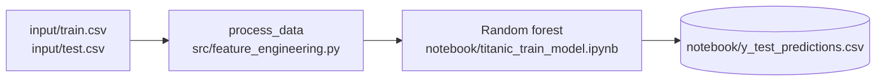

# Architecture

Le projet entraîne un modèle qui prédit la survie des passagers du Titanic.

| Dossier | Rôle |
|---|---|
| `input/` | Données d'entraînement (`train.csv`) et de test (`test.csv`) |
| `src/` | Fonctions de feature engineering, dont `process_data` qui prépare les deux jeux de données |
| `notebook/` | Entraînement du modèle, puis prédictions sur le jeu de test (`y_test_predictions.csv`) |
| `tests/` | Tests unitaires de `src/` |
