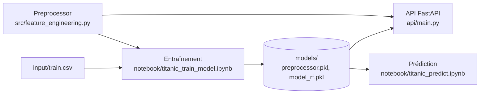

# Architecture

Le projet entraîne un modèle qui prédit la survie des passagers du Titanic, puis l'expose dans une API.

| Dossier | Rôle |
|---|---|
| `input/` | Données d'entraînement (`train.csv`) et de test (`test.csv`) |
| `src/` | Feature engineering : la classe `Preprocessor` et la fonction `process_data` |
| `notebook/` | Entraînement du modèle, et exemple de prédiction |
| `models/` | Préprocesseur et modèle entraînés, enregistrés avec pickle par le notebook d'entraînement |
| `api/` | API FastAPI : charge les fichiers de `models/` et prédit la survie d'un passager (`GET /predict/...`) |
| `tests/` | Tests unitaires de `src/` |
