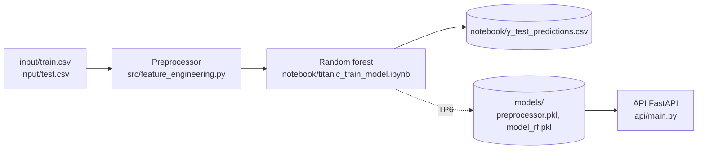

# Architecture

Le projet entraîne un modèle qui prédit la survie des passagers du Titanic. Au TP6, le modèle est enregistré pour être servi par une API.

| Dossier | Rôle |
|---|---|
| `input/` | Données d'entraînement (`train.csv`) et de test (`test.csv`) |
| `src/` | Feature engineering : la classe `Preprocessor`, complétée au TP6, et les fonctions qu'elle utilise |
| `notebook/` | Entraînement du modèle, puis prédictions sur le jeu de test (`y_test_predictions.csv`) |
| `models/` | Préprocesseur et modèle enregistrés avec pickle (vide avant le TP6) |
| `api/` | API FastAPI : charge les fichiers de `models/` et prédit la survie d'un passager (`GET /predict/...`) |
| `tests/` | Tests unitaires de `src/` |
